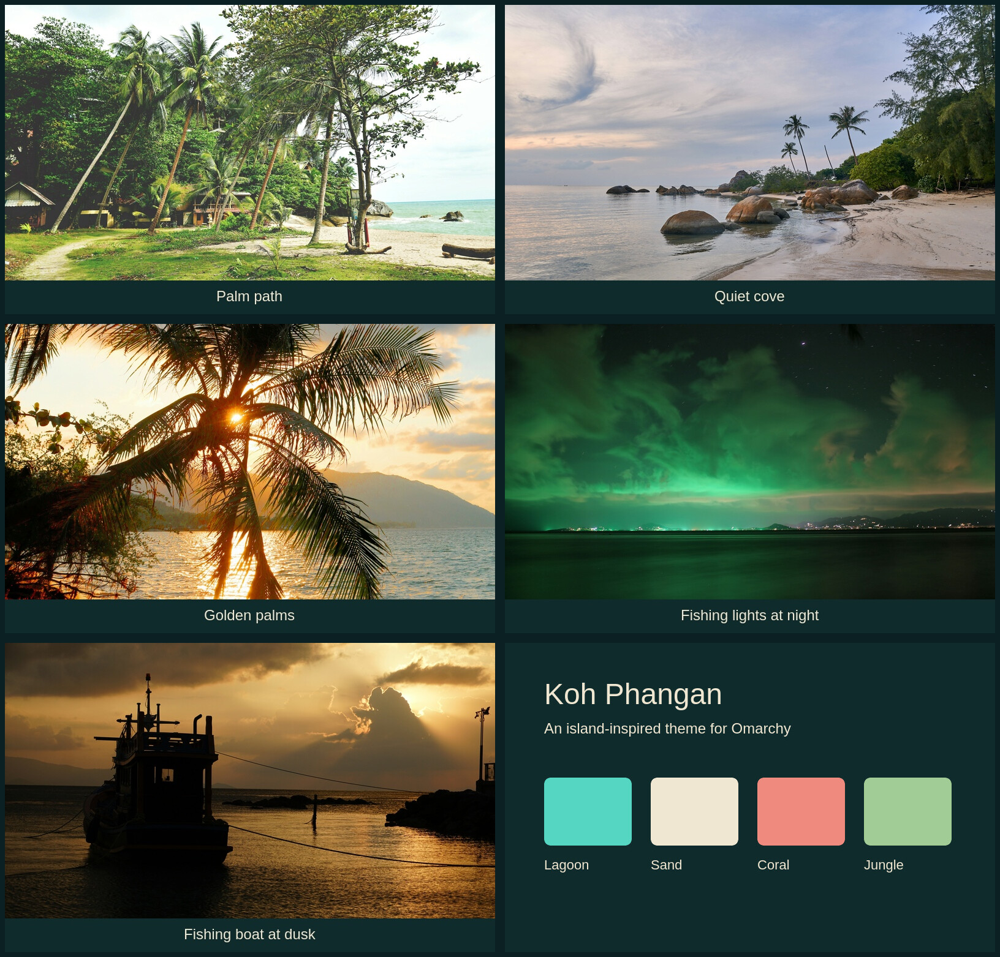

# Koh Phangan for Omarchy

A dark [Omarchy](https://omarchy.org/) theme inspired by Koh Phangan, Thailand: deep lagoon greens, turquoise accents, warm sand text, and coral highlights.



## Install

```sh
omarchy theme install https://github.com/42lizard/omarchy-koh-phangan-theme.git
```

The installer applies the theme. To select it again or cycle its wallpapers:

```sh
omarchy theme set koh-phangan
omarchy theme bg next
```

## Wallpapers

Five real photographs taken on or from Koh Phangan, each cropped to **3840 × 2160**:

| Wallpaper | Photographer |
| --- | --- |
| Palm-lined path to the beach | Tom Lorber |
| Quiet sandy cove | Norbert Braun |
| Golden light through coconut palms | Philipp Potocnik |
| Fishing boat lights over the Gulf at night | Philipp Potocnik |
| Fishing boat at dusk | Ecrinn Burgazlı |

Selected for their island atmosphere and no visible people. The photographs use widescreen crops, with no AI imagery, retouching, or upscaling. The night seascape is a long exposure: the water is smooth and the stars show short trails. The boat photograph is a dusk scene.

See [photograph credits](ATTRIBUTION.md) for source links and licenses, and [the image manifest](MANIFEST.json) for dimensions and crop details.

## Palette

| Role | Color |
| --- | --- |
| Background | `#102B2B` |
| Foreground | `#F0E7D2` |
| Accent | `#55D6C2` |
| Sand | `#E8CD8D` |
| Coral | `#EE8B7E` |
| Jungle | `#A1CC96` |

The theme supplies `colors.toml`; Omarchy generates the supported application configurations from its own templates. Active window borders blend turquoise into sand.

## License

The original theme configuration is [MIT licensed](LICENSE). **Photographs are excluded from that license** and remain under the [Unsplash License](https://unsplash.com/license). The preview contains those photographs and is subject to the same image terms. Retain [ATTRIBUTION.md](ATTRIBUTION.md) when sharing the collection.

This is an independent community theme, with no affiliation with Omarchy or the photographers.
